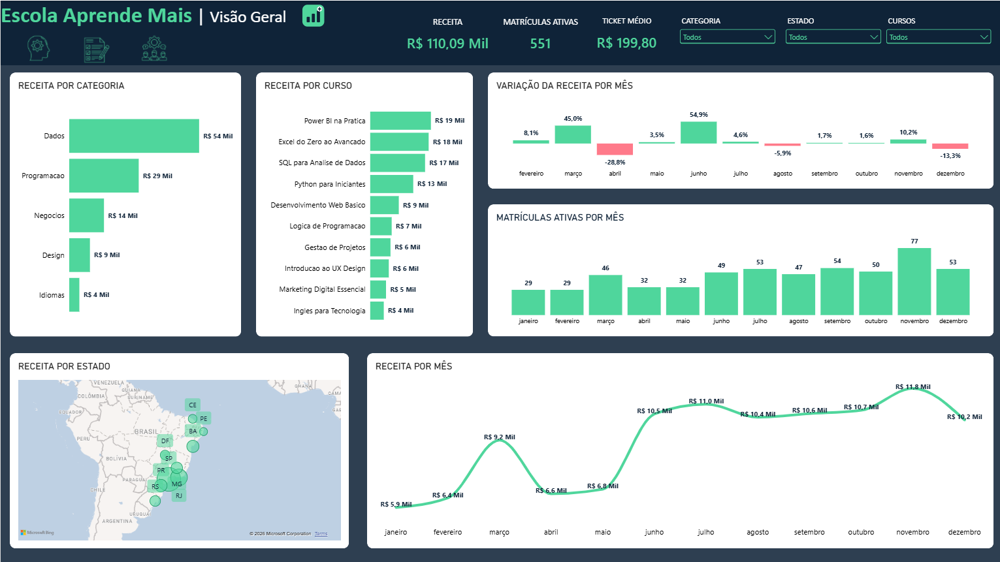
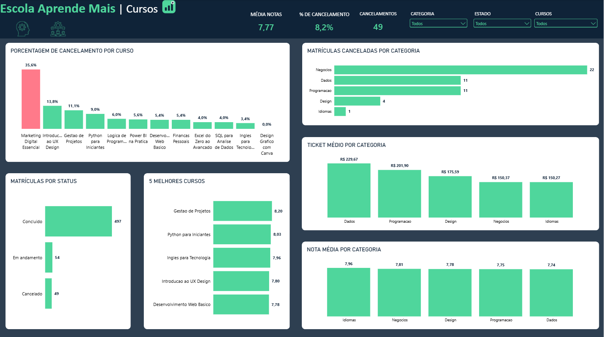
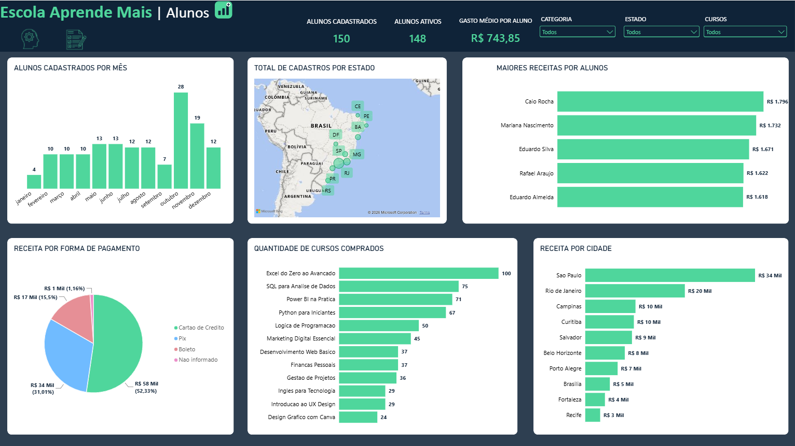
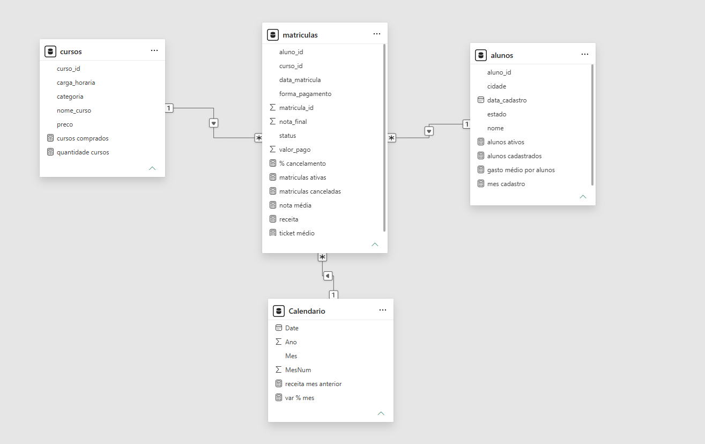

# Análise de Matrículas — Escola Aprende Mais


> Projeto de análise de dados com **SQL Server** e **Power BI** sobre uma escola online de cursos (dados fictícios gerados para estudo).

## Contexto e problema de negócio
A Aprende Mais vende cursos online. A diretoria quer entender **de onde vem a receita, quais cursos perdem alunos e como as vendas se comportam ao longo do ano**, incluindo o efeito da campanha de novembro.

## Dados
Base fictícia com 3 tabelas (2025): `cursos` (12), `alunos` (150) e `matriculas` (600), com sujeira proposital para treinar limpeza.

## Ferramentas
- **SQL Server (T-SQL):** criação de banco com PK/FK, limpeza, JOINs, agregações, CASE WHEN, funções de janela (RANK), view
- **Power BI:** Power Query, modelagem em esquema estrela, tabela calendário, medidas DAX, dashboard de 3 páginas com navegação por botões

## O que eu fiz
1. Criei o banco e as tabelas com chaves primárias e estrangeiras.
2. Tratei inconsistências: 6 cidades fora do padrão de maiúsculas/minúsculas e 6 formas de pagamento vazias (preenchidas com "Nao informado").
3. Respondi perguntas de negócio com SQL, de consultas simples a funções de janela.
4. Modelei os dados no Power BI (esquema estrela, `matriculas` como fato) e criei 12 medidas DAX: Receita, Matrículas Ativas, Ticket Médio, % Cancelamento, Nota Média, Receita do Mês Anterior, Variação % Mês, Alunos Ativos, Gasto Médio por Aluno, entre outras.
5. Construí um dashboard de 3 páginas: **Visão Geral**, **Cursos** e **Alunos**.

## Principais insights
- **Marketing Digital Essencial cancela 35,6%** (16 de 45 matrículas), contra 8,2% da escola toda, ou seja, 4 vezes a média. As notas são parecidas entre os cursos, então o problema é retenção e não qualidade. **Recomendação:** revisar a expectativa criada na venda e o onboarding do curso.
- **Novembro teve 77 matrículas (+54% sobre outubro), mas a receita subiu só 10,2%**, por causa do desconto médio de cerca de 26% na campanha. **Recomendação:** medir a margem da promoção e testar descontos menores.
- **A categoria Dados gera 49% da receita** (R$ 53,9 mil de R$ 110,1 mil), puxada por Power BI na Prática (R$ 18,8 mil). **Recomendação:** investir em novos cursos da área, controlando o risco de dependência.
- **Recompra alta:** 133 dos 150 alunos (89%) compraram 2 cursos ou mais. A retenção de quem entra é boa; o problema está em cursos específicos.

## Números-chave
Receita R$ 110.090,20 · 551 matrículas ativas · ticket médio R$ 199,80 · cancelamento 8,2% · nota média 7,77

## Dashboard
### Visão Geral


### Cursos


### Alunos


### Modelo de dados (esquema estrela)


## Estrutura do repositório
```
├── dados/       cursos.csv, alunos.csv, matriculas.csv
├── sql/         query_criacao.sql, query_analise.sql
├── powerbi/     escola_aprende_mais.pbix
├── prints/      imagens do dashboard
├── logo/        logo e ícones do dashboard
└── README.md
```

## Como reproduzir
1. Execute `sql/query_criacao.sql` no SQL Server para criar o banco e carregar os dados.
2. Rode `sql/query_analise.sql` para ver as consultas de análise e limpeza.
3. Abra o `.pbix` e atualize a conexão para o seu servidor.

## Contato
**Lucas Leonardo Bertolini Salmazzi**  
[LinkedIn](https://www.linkedin.com/in/lucas-leonardo-bertolini-salmazzi-5a6146312) · lucaslbsalmazzi@gmail.com
